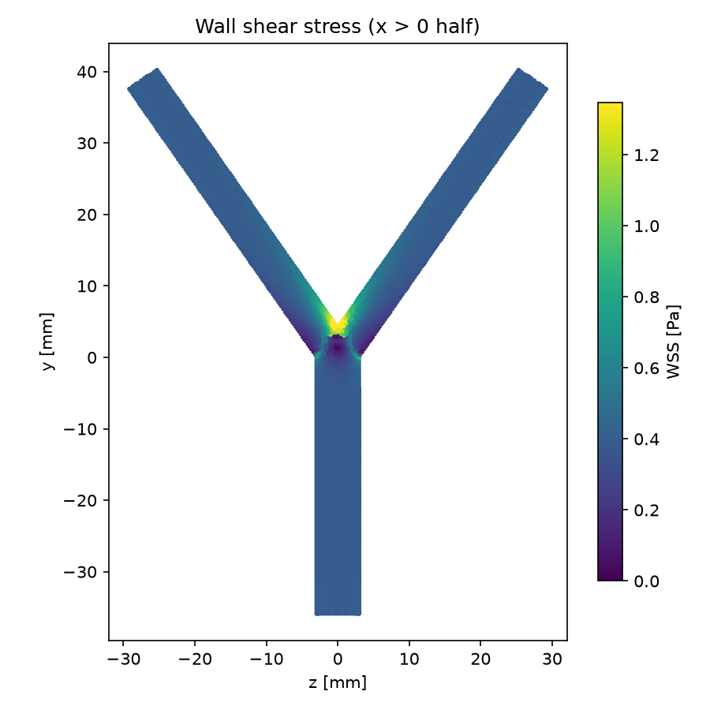

# Arterial bifurcation

Steady laminar flow through an idealised, symmetric arterial bifurcation whose branch radii follow Murray's law. The case exercises an STL-based `snappyHexMesh` workflow and produces the wall-shear-stress pattern typical of bifurcations: a peak at the flow divider (apex) and low shear on the outer walls of the junction.

## Requirements

- OpenFOAM.com v2412
- `blockMesh`, `surfaceFeatureExtract`, `snappyHexMesh`, `checkMesh`, and `simpleFoam`
- MPI, `decomposePar`, `reconstructPar`, and `foamDictionary` only for the parallel workflow
- `python3` with `numpy` for `validate.py` (`matplotlib` is optional and used for the figure)
- `trimesh` and `manifold3d` only to regenerate the geometry (`system/makeGeometry.py`)

## Case layout

```text
0/          Initial velocity (recycled inlet) and pressure
constant/   Fluid and laminar flow dictionaries
            triSurface/bifurcation.stl  vessel surface with INLET, OUTLET1,
                                        OUTLET2 and WALL regions
system/     Background mesh, snappyHexMesh, solver, sampling, and
            decomposition dictionaries
            makeGeometry.py regenerates the STL
validate.py Checks and summary of the solution
Allrun      Mesh, run (serial or parallel), and validate
Allclean    Removes regenerated output only
```

## Model

The geometry lies in the y–z plane:

| Vessel | Radius | Length | Direction |
| --- | --- | --- | --- |
| Parent | Rₚ = 3.000 mm | 6Dₚ upstream of the branch point | +y |
| Daughters (2) | R_d = Rₚ/2^{1/3} = 2.381 mm | 10D_d from the branch point | ±35° from y |

A sphere of radius Rₚ at the branch point blends the outer junction walls. `snappyHexMesh` builds a 0.35 mm hexahedral mesh with three boundary layers on `WALL` (102,972 cells).

- `INLET`: mapped (recycled) velocity sampled 2Dₚ downstream and rescaled to a mean of 0.0825 m/s (fully developed Poiseuille inflow); zero-gradient pressure
- `OUTLET1`, `OUTLET2`: fixed zero pressure; `inletOutlet` velocity
- `WALL`: no-slip

With ν = 3.3 × 10⁻⁶ m²/s the parent Reynolds number is 150 (94 in each daughter). `simpleFoam` (SIMPLEC) is run to a steady state.

Murray's law gives a useful check: with R_d³ = Rₚ³/2 and an even flow split, fully developed Poiseuille flow has the same wall shear stress, 4νU/Rₚ, in the parent and in both daughters.

## Run

```bash
./Allrun
./Allrun parallel
```

Meshing takes under a minute; the 1,500 SIMPLE iterations take about 6 minutes on one core (the solution is unchanged from iteration 1,000 onwards). The parallel run reads the processor count (`4`) from `system/decomposeParDict`. `./Allclean` removes generated results only.

## Validation

Result with OpenFOAM.com v2412:

| Check | Criterion | Result |
| --- | --- | ---: |
| Mass conservation | < 0.5 % | < 0.0001 % |
| Symmetric flow split | < 1 % | 0.009 % |
| Parent pressure gradient = 8νU/Rₚ² | < 5 % | 0.42 % |
| Parent wall shear stress = 4ρνU/Rₚ (0.385 Pa) | < 5 % | 0.44 % |
| Daughter wall shear stress, 7.5–9.5D_d downstream (Murray's law) | < 7 % | 1.27 % |

The peak wall shear stress is 2.19 Pa (5.7 × the parent value), at the flow divider.



## Limitations

The geometry is planar, symmetric, and idealised, the flow is steady, and the wall is rigid. Patient-specific bifurcations (for example the carotid bulb) are asymmetric and non-planar, and their outflow split depends on downstream resistance rather than equal outlet pressures.

## Author, citation, and licence

Author: Chanikya Valeti.

Reference: C. D. Murray, "The physiological principle of minimum work: I. The vascular system and the cost of blood volume", *Proc. Natl. Acad. Sci. USA* 12 (1926) 207–214.

If you use this testcase, please cite this repository and the OpenFOAM version used. No DOI is currently assigned.

No reuse licence is currently granted. Copyright © Chanikya Valeti; all rights reserved.
