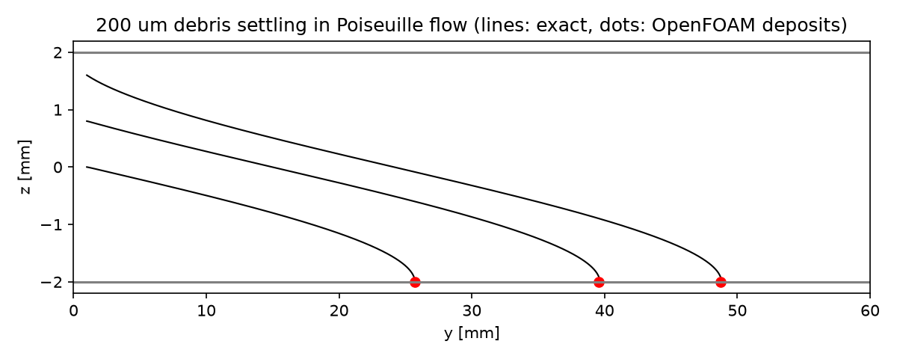

# Particles in blood flow

A verification case for Lagrangian particle tracking in blood: small tracer particles and larger, heavier debris particles (for example calcified plaque fragments or emboli) are released into fully developed flow in an artery. Their motion follows exactly from the drag and gravity laws, so transit times, settling velocities, and deposition points can be checked.

## Requirements

- OpenFOAM.com v2412
- `blockMesh`, `checkMesh`, `setExprFields`, and `icoUncoupledKinematicParcelFoam`
- `python3` with `numpy` for `validate.py` (`matplotlib` is optional and used for the figure)

## Case layout

```text
0.orig/     Initial fields (Allrun copies them to 0/)
constant/   Fluid properties, gravity, particle cloud and release points
system/     Mesh, setExprFields, and solver dictionaries
            makeBlockMeshDict.py regenerates system/blockMeshDict
validate.py Comparison with the exact particle motion
Allrun      Mesh, set the flow, track the particles, and validate
Allclean    Removes regenerated output only (including 0/)
```

## Model

The artery has radius R = 2 mm and length 60 mm along the y-axis (5-block O-grid, 23,040 cells). `setExprFields` imposes the fully developed Poiseuille profile u_y = 2U(1 − r²/R²) with U = 0.05 m/s (Re = 61). The flow is frozen; the particles are one-way coupled (they do not affect the blood).

Blood: ρ = 1060 kg/m³, μ = 3.498 mPa s. Gravity acts across the vessel (−z), as in a horizontal vessel. All particles have density 2000 kg/m³ and start from rest 1 mm downstream of the inlet:

| Particles | Diameter | Release points | Expected behaviour |
| --- | --- | --- | --- |
| Tracers | 1 µm | r/R = 0, 0.2, 0.4, 0.6, 0.8 along +x | Follow the streamlines; leave through `OUTLET` after (L − 1 mm)/u(r) |
| Debris | 200 µm | z/R = 0.8, 0.4, 0 | Settle at 5.43 mm/s and stick to the lower wall |

Particle forces: Schiller–Naumann sphere drag and buoyancy-corrected gravity. `WALL` is sticky; `INLET` and `OUTLET` let particles escape. A `particlePostProcessing` cloud function records every particle that reaches `WALL` or `OUTLET`.

## Run

```bash
./Allrun
```

The whole case runs in a few seconds; `validate.py` takes about 20 seconds. `Allrun` exits with a non-zero status if `validate.py` reports a failure. `./Allclean` removes generated results, including the regenerated `0/` directory.

## Validation

`validate.py` integrates the same equation of motion (drag + gravity) with a fine Runge–Kutta scheme and compares the outcomes.

Result with OpenFOAM.com v2412:

| Tracer r₀/R | Transit time, OpenFOAM (s) | Exact (s) | Error |
| ---: | ---: | ---: | ---: |
| 0.0 | 0.592 | 0.590 | 0.34 % |
| 0.2 | 0.618 | 0.615 | 0.56 % |
| 0.4 | 0.705 | 0.702 | 0.37 % |
| 0.6 | 0.922 | 0.922 | 0.01 % |
| 0.8 | 1.621 | 1.639 | 1.09 % |

| Debris z₀/R | Deposition point, OpenFOAM (mm) | Exact (mm) | Error |
| ---: | ---: | ---: | ---: |
| 0.8 | 48.72 | 48.81 | 0.19 % |
| 0.4 | 39.56 | 39.65 | 0.23 % |
| 0.0 | 25.70 | 25.73 | 0.09 % |

The settling velocity is 5.425 mm/s against an exact value of 5.427 mm/s. The Stokes-law value, 5.858 mm/s, is 8 % too high at this particle Reynolds number (0.33), which shows why the drag correction matters. Tolerances: transit times and deposition points 2 %, settling velocity 1 %. Tracer transit times are resolved to one time step (1 ms).



## Limitations

The particles are rigid spheres that do not interact with each other or with the flow, and the wall is perfectly sticky. Lift forces (for example the Segré–Silberberg migration of neutrally buoyant particles), red-cell interactions, and adhesion kinetics are not modelled. Add `pressureGradient`, `virtualMass`, or `SaffmanMeiLiftForce` under `particleForces` to study them.

## Author, citation, and licence

Author: Chanikya Valeti.

Reference: L. Schiller and A. Naumann, "Über die grundlegenden Berechnungen bei der Schwerkraftaufbereitung", *Z. Ver. Dtsch. Ing.* 77 (1933) 318–320.

If you use this testcase, please cite this repository and the OpenFOAM version used. No DOI is currently assigned.

No reuse licence is currently granted. Copyright © Chanikya Valeti; all rights reserved.
