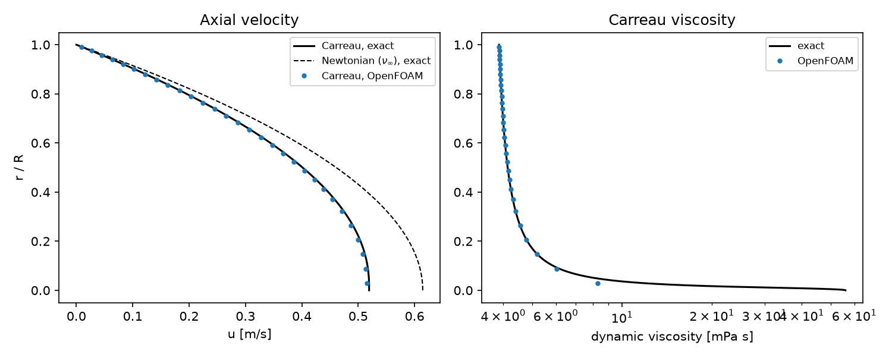

# Carreau blood flow in a tube

A verification case for shear-thinning blood rheology: steady, fully developed flow of a Carreau fluid in a straight rigid tube. The velocity and viscosity profiles are compared with the exact solution, which follows from the linear shear-stress distribution across the tube.

## Requirements

- OpenFOAM.com v2412
- `blockMesh`, `checkMesh`, and `simpleFoam`
- `python3` with `numpy` for `validate.py` (`matplotlib` is optional and used for the figure)

## Case layout

```text
0/          Initial velocity and pressure
constant/   Carreau viscosity model and laminar flow dictionaries
system/     Mesh, solver, and sampling dictionaries
            makeBlockMeshDict.py regenerates system/blockMeshDict
validate.py Comparison with the exact Carreau tube-flow solution
Allrun      Mesh, run, and validate
Allclean    Removes regenerated output only
```

## Model

The tube has radius R = 2 mm (a small artery) and length 10 mm along the y-axis, meshed with a 5-block O-grid (5,184 hexahedral cells). A kinematic pressure drop of 0.02 m²/s² over the tube gives a uniform gradient G = 2 m/s² (about 2.1 kPa/m with ρ = 1060 kg/m³); velocity is zero-gradient at the ends and no-slip at the wall.

Blood viscosity follows the Carreau model of Cho and Kensey (1991), entered as OpenFOAM's `BirdCarreau` model with kinematic viscosities:

| Parameter | Dynamic value | OpenFOAM entry |
| --- | --- | --- |
| Zero-shear viscosity | 0.056 Pa s | `nu0 5.2830e-05` |
| Infinite-shear viscosity | 0.00345 Pa s | `nuInf 3.2547e-06` |
| Time constant λ | 3.313 s | `k 3.313` |
| Power-law index | 0.3568 | `n 0.3568` |
| Yasuda exponent | 2 (Carreau) | `a 2` |

Exact solution: the shear stress is τ(r)/ρ = G r / 2 = ν(γ̇) γ̇, which is solved for the local shear rate γ̇(r); the velocity is u(r) = ∫ᵣᴿ γ̇ ds. The wall shear rate is 548 s⁻¹ and the shear rate falls to zero on the axis, so the viscosity varies by more than an order of magnitude across the tube.

## Run

```bash
./Allrun
```

The run takes under a minute on one core. `Allrun` exits with a non-zero status if `validate.py` reports a failure. For a Newtonian reference, replace the model in `constant/transportProperties` with `transportModel Newtonian; nu 3.255e-06;`. `./Allclean` removes generated results only.

## Validation

Result with OpenFOAM.com v2412 (tolerance 2 %):

| Quantity | OpenFOAM | Exact | Error |
| --- | ---: | ---: | ---: |
| Centreline velocity (m/s) | 0.5153 | 0.5194 | 0.76 % (max over profile) |
| Flow rate (mL/min) | 200.2 | 201.9 | 0.84 % |
| Viscosity, r > R/5 | | | 0.13 % (max) |

A Newtonian fluid with the high-shear viscosity would carry 231.7 mL/min with a centreline velocity of 0.6145 m/s, so shear thinning blunts the profile and reduces the flow by about 13 % at this pressure gradient.



The viscosity check excludes the inner fifth of the radius: the shear rate vanishes on the axis, where the Carreau viscosity changes too steeply for a cell average to match point values.

## Limitations

The Carreau model represents shear thinning only; yield stress, thixotropy, viscoelasticity, and the Fåhræus–Lindqvist effect in small vessels are not modelled.

## Author, citation, and licence

Author: Chanikya Valeti.

Reference: Y. I. Cho and K. R. Kensey, "Effects of the non-Newtonian viscosity of blood on flows in a diseased arterial vessel. Part 1: Steady flows", *Biorheology* 28 (1991) 241–262.

If you use this testcase, please cite this repository and the OpenFOAM version used. No DOI is currently assigned.

No reuse licence is currently granted. Copyright © Chanikya Valeti; all rights reserved.
