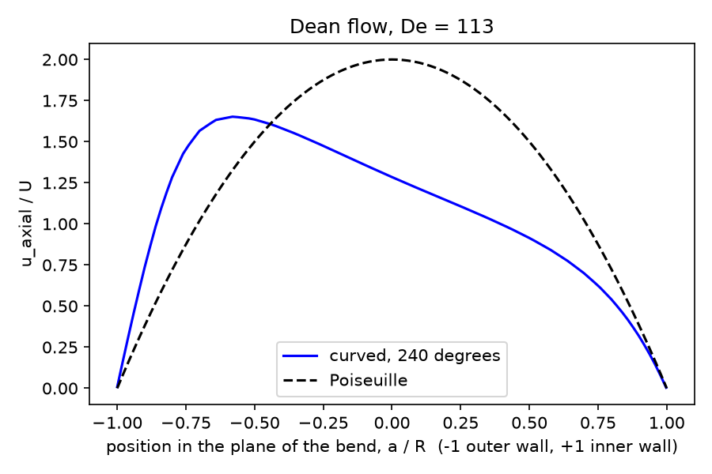

# Curved artery (Dean flow)

Steady laminar flow through a strongly curved artery, such as a coronary artery on the heart surface or the aortic arch. Centrifugal forces drive a pair of counter-rotating secondary (Dean) vortices, push the axial velocity peak towards the outer wall, and raise the pressure drop above the straight-tube value. The Dean number De = Re√(R/R_c) controls these effects, and the friction-factor increase is compared with published curved-pipe correlations.

## Requirements

- OpenFOAM.com v2412
- `blockMesh`, `checkMesh`, and `simpleFoam`
- `python3` with `numpy` for `validate.py` (`matplotlib` is optional and used for the figure)

## Case layout

```text
0/          Recycled inlet velocity and pressure
constant/   Fluid and laminar flow dictionaries
system/     Mesh, solver, and sampling dictionaries
            makeBlockMeshDict.py regenerates system/blockMeshDict
validate.py Checks and friction-factor comparison
Allrun      Mesh, run, and validate
Allclean    Removes regenerated output only
```

## Model

A D = 4 mm tube runs along +y for a 4D straight inlet leg and then turns through 300° in the y–z plane with centreline radius R_c = 7R (curvature ratio R/R_c = 1/7). The outlet is at the end of the bend. The block mesh carries an O-grid cross-section every 2.5° of the bend (68,096 hexahedral cells).

- `INLET`: velocity recycled from 2D downstream in the inlet leg and rescaled to 0.2475 m/s (fully developed Poiseuille inflow); zero-gradient pressure
- `OUTLET`: fixed zero pressure; `inletOutlet` velocity
- `WALL`: no-slip

With ν = 3.3 × 10⁻⁶ m²/s, Re = 300 and De = 113. `simpleFoam` (SIMPLEC) runs 1,000 iterations. Area-averaged pressures on cross-sections at 120°, 165°, 210°, and 255° give the pressure gradient along the bend.

## Run

```bash
./Allrun
```

The run takes about 4 minutes on one core. `Allrun` exits with a non-zero status if `validate.py` reports a failure. `./Allclean` removes generated results only.

## Validation

Result with OpenFOAM.com v2412:

| Check | Criterion | Result |
| --- | --- | ---: |
| Mass conservation | < 0.1 % | < 0.0001 % |
| Straight inlet leg: Poiseuille pressure gradient | < 3 % | 1.10 % |
| Bend pressure gradient settles (successive 45° changes shrink) | decreasing | 10.3 % → 3.9 % |
| Friction-factor ratio f_c/f_s over 165–255° vs Mishra & Gupta | < 5 % | 1.556 vs 1.588 (2.0 %) |
| Axial velocity peak on the outer side of the bend | > 0.05R | 0.58R |

At this Dean number the developing flow approaches its developed state through a damped oscillation of the pressure gradient (2.75, 2.49, and 2.59 m/s² over successive 45° intervals). The friction-factor ratio is therefore averaged over the last 90°. Published correlations give 1.588 (Mishra & Gupta, 1979) and 1.604 (White, 1929) at De = 113, so the computed 1.556 lies 2–3 % below them.



The velocity profile across the plane of the bend at 240° shows the peak displaced to the outer wall (1.65U instead of the Poiseuille 2U on the axis).

## Limitations

The bend is planar with constant curvature and no torsion. Real coronary arteries are non-planar and move with the heart, and the aortic arch has branches and pulsatile, partly turbulent flow.

## Author, citation, and licence

Author: Chanikya Valeti.

References:

- W. R. Dean, "The stream-line motion of fluid in a curved pipe", *Phil. Mag.* 5 (1928) 673–695.
- C. M. White, "Streamline flow through curved pipes", *Proc. R. Soc. Lond. A* 123 (1929) 645–663.
- P. Mishra and S. N. Gupta, "Momentum transfer in curved pipes. 1. Newtonian fluids", *Ind. Eng. Chem. Process Des. Dev.* 18 (1979) 130–137.

If you use this testcase, please cite this repository and the OpenFOAM version used. No DOI is currently assigned.

No reuse licence is currently granted. Copyright © Chanikya Valeti; all rights reserved.
