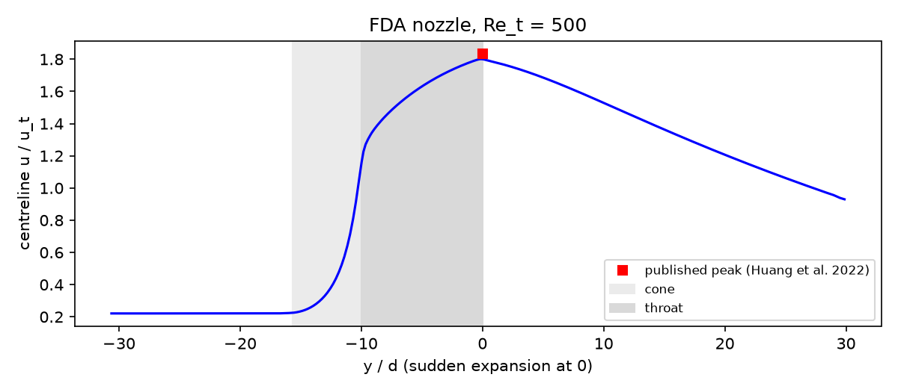

# FDA benchmark nozzle

The U.S. Food and Drug Administration's benchmark nozzle, an idealised blood-contacting medical device: a conical contraction into a narrow throat followed by a sudden expansion. It is the standard test geometry for CFD of blood flow in devices, because the high-shear throat and the free jet downstream combine the features that drive haemolysis and platelet activation. This case runs the laminar benchmark condition, throat Reynolds number 500.

## Requirements

- OpenFOAM.com v2412
- `blockMesh`, `checkMesh`, and `simpleFoam`
- MPI, `decomposePar`, `reconstructPar`, and `foamDictionary` only for the parallel workflow
- `python3` with `numpy` for `validate.py` (`matplotlib` is optional and used for the figure)

## Case layout

```text
0/          Recycled inlet velocity and pressure
constant/   Fluid and laminar flow dictionaries
system/     Mesh, solver, sampling, and decomposition dictionaries
            makeBlockMeshDict.py regenerates system/blockMeshDict
validate.py Checks and centreline summary
Allrun      Mesh, run (serial or parallel), and validate
Allclean    Removes regenerated output only
```

## Model

Benchmark geometry in the sudden-expansion orientation, with flow along +y and the expansion at y = 0:

| Section | Diameter | Axial extent |
| --- | --- | --- |
| Inlet pipe | 12 mm | −122.7 to −62.7 mm (5D) |
| Conical contraction (20° included angle) | 12 → 4 mm | −62.7 to −40 mm |
| Throat | 4 mm | −40 to 0 mm |
| Outlet pipe after the sudden expansion | 12 mm | 0 to +120 mm (30 throat diameters) |

The block mesh follows the wall with an O-grid up to the expansion. Downstream, the O-grid continues as the jet core and an outer ring of blocks fills the 12 mm pipe, so there are no hanging nodes (198,400 hexahedral cells).

- `INLET`: velocity recycled from 2D downstream and rescaled to 0.04583 m/s (fully developed, inlet Re = 167); zero-gradient pressure
- `OUTLET`: fixed zero pressure; `inletOutlet` velocity
- `WALL`: no-slip

With ν = 3.3 × 10⁻⁶ m²/s, the throat mean velocity is 0.4125 m/s, giving Re_t = 500. `simpleFoam` (SIMPLEC) converges in about 1,100 iterations.

## Run

```bash
./Allrun
./Allrun parallel
```

The serial run takes about 12–18 minutes on one core. The parallel run reads the processor count (`4`) from `system/decomposeParDict`. `./Allclean` removes generated results only.

## Validation

Result with OpenFOAM.com v2412:

| Check | Criterion | Result |
| --- | --- | ---: |
| Mass conservation | < 0.1 % | < 0.0001 % |
| Fully developed inflow: centreline = 2U | < 3 % | 0.58 % |
| Fully developed inflow: Poiseuille pressure gradient | < 3 % | 0.80 % |
| Centreline velocity at the expansion vs published value, 1.834 u_t | < 5 % | 1.800 u_t (1.87 %) |
| Axisymmetric jet: cross-stream centreline velocity | < 1 % of u_t | 0.002 % |

The published value is the peak centreline velocity at the expansion, 0.76 m/s at a throat velocity of 0.4143 m/s (Huang et al., 2022; their fluid properties were ρ = 1056 kg/m³, μ = 3.5 mPa s). Downstream, the laminar jet decays almost linearly and still carries 0.93 u_t on the centreline at the outlet. The pressure drop from the inlet pipe (y = −80 mm) to the throat exit is 307 Pa.



The FDA inter-laboratory PIV measurements for all five benchmark Reynolds numbers are published by Hariharan et al. (2011) and can be compared with the `centreline` sample in `postProcessing/lines`.

## Limitations

Only the laminar condition is included. At Re_t ≥ 2000 the jet becomes transitional and needs a transient, scale-resolving simulation on a much finer mesh. Blood damage (haemolysis) models are not included; they can be evaluated from the velocity field in post-processing.

## Author, citation, and licence

Author: Chanikya Valeti.

References:

- P. Hariharan et al., "Multilaboratory particle image velocimetry analysis of the FDA benchmark nozzle model to support validation of computational fluid dynamics simulations", *J. Biomech. Eng.* 133 (2011) 041002.
- F. Huang, R. Noël, P. Berg and S. A. Hosseini, "Simulation of the FDA nozzle benchmark: a lattice Boltzmann study", arXiv:2204.10566 (2022).

If you use this testcase, please cite this repository and the OpenFOAM version used. No DOI is currently assigned.

No reuse licence is currently granted. Copyright © Chanikya Valeti; all rights reserved.
