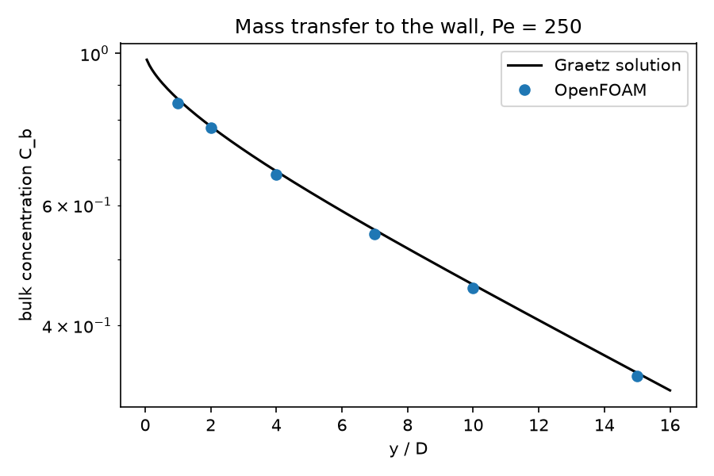

# Graetz mass transfer in an arteriole

A verification case for species transport in blood vessels: a dissolved species such as oxygen enters a small vessel at uniform concentration and is consumed at the vessel wall by the surrounding tissue. This is the classical Graetz problem, so the bulk concentration along the vessel and the fully developed Sherwood number (3.657) are known exactly.

## Requirements

- OpenFOAM.com v2412
- `blockMesh`, `checkMesh`, and `simpleFoam` (the species is solved by the `scalarTransport` function object)
- `python3` with `numpy` for `validate.py` (`matplotlib` is optional and used for the figure)

## Case layout

```text
0/          Velocity (recycled inlet), pressure, and concentration C
constant/   Fluid and laminar flow dictionaries
system/     Mesh, solver, species-transport, and sampling dictionaries
            makeBlockMeshDict.py regenerates system/blockMeshDict
validate.py Comparison with the Graetz solution
Allrun      Mesh, run, and validate
Allclean    Removes regenerated output only
```

## Model

The vessel is a 100 µm arteriole, 20 diameters long, along the y-axis (5-block O-grid, 129,600 cells). The velocity inlet is recycled from 2D downstream and rescaled to a mean of 5 mm/s, so a fully developed Poiseuille profile enters the vessel (Re = 0.15).

The normalised concentration C is 1 at `INLET` and 0 at `WALL`; the wall acts as a perfect sink. `scalarTransport` solves steady advection–diffusion of C with diffusivity 2 × 10⁻⁹ m²/s (oxygen in plasma), giving a Péclet number Pe = UD/D_C = 250.

The reference is the Graetz solution (no axial diffusion): u(r) ∂C/∂y = D_C (1/r) ∂/∂r (r ∂C/∂r). `validate.py` solves it with a 400-point radial discretisation. At Pe = 250, axial diffusion is negligible beyond one diameter from the inlet.

At the arteriole scale blood is not a continuum (red cells are 8 µm across); the case verifies the transport model rather than blood rheology.

## Run

```bash
./Allrun
```

The run takes about 10 minutes on one core. `Allrun` exits with a non-zero status if `validate.py` reports a failure. `./Allclean` removes generated results only.

## Validation

The bulk (flow-weighted) concentration is computed from radial profiles at six stations. The fully developed Sherwood number follows from its decay rate between 10D and 15D: d(ln C_b)/dy = −4 Sh / (D Pe).

Result with OpenFOAM.com v2412 (tolerance 2 %):

| y/D | C_b, OpenFOAM | C_b, Graetz | Error |
| ---: | ---: | ---: | ---: |
| 1 | 0.8469 | 0.8572 | 1.21 % |
| 2 | 0.7786 | 0.7822 | 0.45 % |
| 4 | 0.6643 | 0.6724 | 1.21 % |
| 7 | 0.5446 | 0.5519 | 1.32 % |
| 10 | 0.4536 | 0.4590 | 1.18 % |
| 15 | 0.3375 | 0.3410 | 1.01 % |
| Sherwood number, 10–15D | 3.694 | 3.657 | 1.02 % |



## Limitations

The wall is a perfect sink (C = 0). Real oxygen transport also depends on haemoglobin binding, wall permeability, and tissue consumption kinetics; these can be added as source terms (`fvOptions`) or as a mixed boundary condition.

## Author, citation, and licence

Author: Chanikya Valeti.

Reference: R. K. Shah and A. L. London, *Laminar Flow Forced Convection in Ducts*, Academic Press (1978).

If you use this testcase, please cite this repository and the OpenFOAM version used. No DOI is currently assigned.

No reuse licence is currently granted. Copyright © Chanikya Valeti; all rights reserved.
