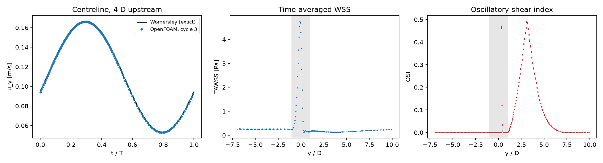

# Pulsatile flow through a stenosis

Pulsatile laminar flow through the same smooth 75 % (area) stenosis as `stenosedArtery`, driven by a heartbeat-like inflow. The case produces the two haemodynamic indices most used to relate flow to atherosclerosis: the time-averaged wall shear stress (TAWSS) and the oscillatory shear index (OSI).

## Requirements

- OpenFOAM.com v2412
- `blockMesh`, `checkMesh`, and `pimpleFoam`
- MPI, `decomposePar`, `reconstructPar`, and `foamDictionary` only for the parallel workflow
- `python3` (standard library) to generate the inflow profile, and `numpy` for `validate.py` (`matplotlib` is optional and used for the figure)

## Case layout

```text
0/          Pulsatile inflow and pressure
constant/   Fluid and laminar flow dictionaries
system/     Mesh, solver, averaging, sampling, and decomposition dictionaries
            makeBlockMeshDict.py regenerates system/blockMeshDict
            makeWomersleyInlet.py writes the inflow profile (run by Allrun)
validate.py Checks, TAWSS and OSI
Allrun      Mesh, run (serial or parallel), and validate
Allclean    Removes regenerated output only
```

## Model

The vessel has diameter D = 6 mm and runs along the y-axis from −7D to +10D, with a cosine stenosis (radius halved at the throat) between −D and +D (97,920 hexahedral cells).

- `INLET`: the exact fully developed (Womersley) velocity profile for Q(t) = Qm[1 + 0.6 sin(2πt)], Qm = 93.3 mL/min (period 1 s, 60 beats/min). `system/makeWomersleyInlet.py` writes it to `constant/boundaryData/INLET` every 5 ms, and `timeVaryingMappedFixedValue` interpolates it onto the inlet faces with the exact mean velocity enforced. A measured waveform can be imposed the same way.
- `OUTLET`: fixed zero pressure; `inletOutlet` velocity
- `WALL`: no-slip

With ν = 3.3 × 10⁻⁶ m²/s, the Reynolds number varies between 40 and 160 (mean 100) and the Womersley number is α = 4.1. `pimpleFoam` runs three cycles with second-order time stepping and an adaptive time step (Courant number ≤ 0.9). `fieldAverage` accumulates over the third cycle

TAWSS = mean(|τ_w|),  OSI = ½ (1 − |mean(τ_w)| / mean(|τ_w|)),

so OSI is 0 where the wall shear never changes direction and approaches 0.5 where it reverses for half the cycle.

## Run

```bash
./Allrun
./Allrun parallel
```

The parallel run reads the processor count (`4`) from `system/decomposeParDict`. The three cycles take about 55 minutes on two cores (about 1.5–2 hours on one). `./Allclean` removes generated results only.

## Validation

`validate.py` applies five checks (result with OpenFOAM.com v2412):

| Check | Criterion | Result |
| --- | --- | ---: |
| Mass conservation, every step of cycle 3 | < 0.1 % of mean flow | < 0.0001 % |
| Centreline velocity 4D upstream (3D into the domain) vs exact Womersley solution | < 3 % of peak | 0.45 % |
| Wall-averaged WSS, cycle 3 vs cycle 2 | < 2 % of peak | < 0.001 % |
| 0 ≤ OSI ≤ 0.5 everywhere | — | yes |
| Oscillatory shear downstream of the throat | OSI > 0.1 | 0.493 |

Summary of the indices (ρ = 1060 kg/m³):

| Quantity | Value |
| --- | ---: |
| TAWSS upstream (steady Poiseuille at the mean flow: 0.2565 Pa) | 0.2582 Pa |
| Peak TAWSS, at the throat | 4.76 Pa |
| Peak OSI, downstream of the throat | 0.493 at y = 3.1D |



## Limitations

The wall is rigid, the blood Newtonian, and the inflow a single harmonic without flow reversal. For a measured flow waveform, add its harmonics to `makeWomersleyInlet.py` (the Womersley solution is linear, so the harmonics superpose). A finer mesh and smaller time step are needed at higher Reynolds numbers, where the post-stenotic jet becomes unstable.

## Author, citation, and licence

Author: Chanikya Valeti.

Reference: X. He and D. N. Ku, "Pulsatile flow in the human left coronary artery bifurcation: average conditions", *J. Biomech. Eng.* 118 (1996) 74–82 (definition of the oscillatory shear index).

If you use this testcase, please cite this repository and the OpenFOAM version used. No DOI is currently assigned.

No reuse licence is currently granted. Copyright © Chanikya Valeti; all rights reserved.
