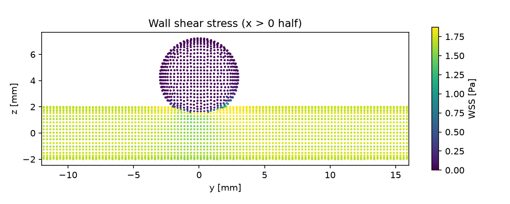

# Sidewall saccular aneurysm

Steady laminar flow past an idealised saccular (berry) aneurysm on the side of a straight artery, such as an internal carotid aneurysm. Only a small part of the parent flow enters the sac, where it drives a slow vortex. The resulting low wall shear stress on the aneurysm dome is the haemodynamic factor most often linked to wall remodelling and rupture risk.

## Requirements

- OpenFOAM.com v2412
- `blockMesh`, `surfaceFeatureExtract`, `snappyHexMesh`, `checkMesh`, and `simpleFoam`
- MPI, `decomposePar`, `reconstructPar`, and `foamDictionary` only for the parallel workflow
- `python3` with `numpy` for `validate.py` (`matplotlib` is optional and used for the figure)
- `trimesh` and `manifold3d` only to regenerate the geometry (`system/makeGeometry.py`)

## Case layout

```text
0/          Recycled inlet velocity and pressure
constant/   Fluid and laminar flow dictionaries
            triSurface/aneurysm.stl  surface with INLET, OUTLET and WALL regions
system/     Background mesh, snappyHexMesh, solver, sampling, and
            decomposition dictionaries
            makeGeometry.py regenerates the STL
validate.py Checks and aneurysm haemodynamics
Allrun      Mesh, run (serial or parallel), and validate
Allclean    Removes regenerated output only
```

## Model

| Feature | Value |
| --- | --- |
| Parent artery | D = 4 mm, along y from −8D to +12D |
| Aneurysm sac | Sphere of 6 mm diameter on the +z side, centred above y = 0 |
| Neck width | 4 mm |
| Dome height (from the neck plane) | 5.24 mm |
| Aspect ratio (height / neck) | 1.31 |

`snappyHexMesh` builds a 0.25 mm hexahedral mesh with three boundary layers on `WALL` (115,742 cells).

- `INLET`: velocity recycled from 2D downstream and rescaled to 0.2475 m/s (fully developed Poiseuille inflow); zero-gradient pressure
- `OUTLET`: fixed zero pressure; `inletOutlet` velocity
- `WALL`: no-slip

With ν = 3.3 × 10⁻⁶ m²/s, Re = 300. `simpleFoam` (SIMPLEC) runs 1,500 iterations without a residual stop: the sac vortex carries little weight in the global residuals, so its convergence is checked separately with two velocity probes inside the sac.

## Run

```bash
./Allrun
./Allrun parallel
```

Meshing takes under a minute and the solver about 6–10 minutes on one core. The parallel run reads the processor count (`4`) from `system/decomposeParDict`. `./Allclean` removes generated results only.

## Validation

Result with OpenFOAM.com v2412:

| Check | Criterion | Result |
| --- | --- | ---: |
| Mass conservation | < 0.5 % | < 0.0001 % |
| Parent pressure gradient upstream = 8νU/R² | < 5 % | 3.22 % |
| Parent wall shear stress upstream = 4ρνU/R (1.73 Pa) | < 5 % | 2.26 % |
| Wall shear stress recovered downstream | < 5 % | 0.71 % |
| Sac is a low-shear region (mean WSS below parent) | yes | 0.049 Pa vs 1.69 Pa |
| Sac vortex converged (probe speeds over the last 300 iterations) | < 1 % change | 0.000 % |

Aneurysm haemodynamics (ρ = 1060 kg/m³):

| Quantity | Value |
| --- | ---: |
| Parent flow entering the sac | 0.56 % |
| Mean WSS on the sac / dome | 0.049 / 0.025 Pa (3 % / 1 % of the parent value) |
| Sac wall with WSS < 0.4 Pa | 98.8 % |
| Vortex speed at the sac centre / near the dome | 7.2 / 4.2 mm/s |



The shear is highest where the inflow jet impinges on the distal neck. The two halves of the sac (x > 0 and x < 0) differ by about 8 % in mean WSS: the geometry is symmetric but the `snappyHexMesh` mesh is not, and the sac shear is small enough for this to show.

## Limitations

The flow is steady, whereas aneurysm inflow varies strongly over the cardiac cycle (combine with the pulsatile set-up of `pulsatileStenosis` for TAWSS and OSI). The geometry is idealised, the wall rigid, and the blood Newtonian. The low shear in the sac is where non-Newtonian blood behaviour matters most (see `carreauBloodPipe`).

## Author, citation, and licence

Author: Chanikya Valeti.

Reference: J. R. Cebral, F. Mut, J. Weir and C. M. Putman, "Association of hemodynamic characteristics and cerebral aneurysm rupture", *Am. J. Neuroradiol.* 32 (2011) 264–270.

If you use this testcase, please cite this repository and the OpenFOAM version used. No DOI is currently assigned.

No reuse licence is currently granted. Copyright © Chanikya Valeti; all rights reserved.
