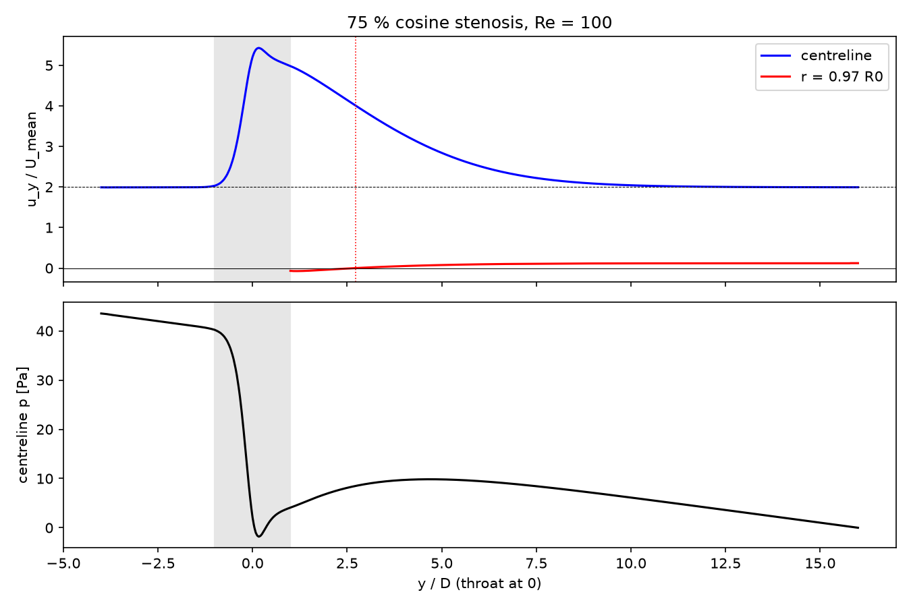

# Stenosed artery

Steady laminar flow through a smooth, axisymmetric 75 % (area) stenosis — the standard idealised model of an atherosclerotic narrowing. The case resolves the throat jet, the post-stenotic recirculation zone, and the downstream recovery to Poiseuille flow, and can be run with Newtonian or Carreau blood.

## Requirements

- OpenFOAM.com v2412
- `blockMesh`, `checkMesh`, and `simpleFoam`
- MPI, `decomposePar`, `reconstructPar`, and `foamDictionary` only for the parallel workflow
- `python3` with `numpy` for `validate.py` (`matplotlib` is optional and used for the figure)

## Case layout

```text
0/          Initial velocity (recycled inlet) and pressure
constant/   Fluid and laminar flow dictionaries
            transportProperties.carreau holds the Carreau blood model
system/     Mesh, solver, sampling, and decomposition dictionaries
            makeBlockMeshDict.py regenerates system/blockMeshDict
validate.py Checks and summary of the solution
Allrun      Mesh, run (serial or parallel, Newtonian or Carreau), and validate
Allclean    Removes regenerated output only
```

## Model

The vessel has diameter D = 6 mm and lies along the y-axis from −4D to +16D, with the throat at y = 0. Its radius is

r(y) = R₀ [1 − (S/2)(1 + cos(πy/D))] for |y| < D,  r = R₀ otherwise,

with S = 0.5, so the throat radius is R₀/2 and the area is reduced by 75 %. This is the geometry of Varghese, Frankel and Fischer (2007). The block mesh carries its own cross-section at each of 49 axial stations through the stenosis, so the wall follows the cosine profile without a separate projection step (146,520 hexahedral cells).

- `INLET`: mapped (recycled) velocity sampled 1.5D downstream and rescaled to a mean of 0.055 m/s, giving a fully developed Poiseuille inflow; zero-gradient pressure
- `OUTLET`: fixed zero pressure; `inletOutlet` velocity
- `WALL`: no-slip

With ν = 3.3 × 10⁻⁶ m²/s the Reynolds number is Re = UD/ν = 100. `simpleFoam` (SIMPLEC) is run to a steady state.

## Run

```bash
./Allrun                    # serial, Newtonian
./Allrun parallel           # uses numberOfSubdomains (4) from system/decomposeParDict
./Allrun serial carreau     # Carreau blood (see carreauBloodPipe)
```

The serial Newtonian run converges in about 130 SIMPLE iterations (about 3 minutes on one core); the Carreau run needs about 190. The `carreau` option copies `constant/transportProperties.carreau` to `constant/transportProperties.local`, which `constant/transportProperties` includes; running without `carreau` removes that file again. `./Allclean` removes generated results only.

## Validation

`validate.py` applies five checks. Checks 2, 3, and 5 compare with Newtonian Poiseuille flow and are therefore reported, but not applied, for the Carreau run.

| Check | Criterion | Newtonian result |
| --- | --- | ---: |
| 1. Mass conservation | < 0.1 % | < 0.0001 % |
| 2. Fully developed inlet (centreline = 2U) | < 2 % | 0.48 % |
| 3. Upstream pressure gradient = 8νU/R₀² | < 3 % | 0.91 % |
| 4. Recirculation reattaches inside the domain | yes | 2.72D |
| 5. Centreline recovers to 2U at y = 15.5D | < 3 % | 0.33 % |

Summary with OpenFOAM.com v2412:

| Quantity | Newtonian | Carreau |
| --- | ---: | ---: |
| Throat centreline velocity | 5.21 U | 5.23 U |
| Reattachment point (from throat) | 2.72D | 1.93D |
| Pressure loss between −2D and +12D above fully developed flow (ρ = 1060 kg/m³) | 22.9 Pa | 23.4 Pa |

With Carreau blood the low-shear viscosity near the wall and in the recirculation zone is higher, so the upstream pressure gradient rises by about 50 % for the same flow rate and the recirculation zone is about 30 % shorter.

The reattachment point is taken where the axial velocity 0.09 mm from the wall (r = 0.97R₀) changes sign, which approximates the zero of wall shear stress.



## Limitations

The flow is steady and the wall rigid. At higher Reynolds numbers or with pulsatile inflow, the post-stenotic jet can become unsteady and asymmetric (Varghese et al., 2007); such runs need a transient solver and a finer mesh than this case provides.

## Author, citation, and licence

Author: Chanikya Valeti.

Reference: S. S. Varghese, S. H. Frankel and P. F. Fischer, "Direct numerical simulation of stenotic flows. Part 1. Steady flow", *J. Fluid Mech.* 582 (2007) 253–280.

If you use this testcase, please cite this repository and the OpenFOAM version used. No DOI is currently assigned.

No reuse licence is currently granted. Copyright © Chanikya Valeti; all rights reserved.
