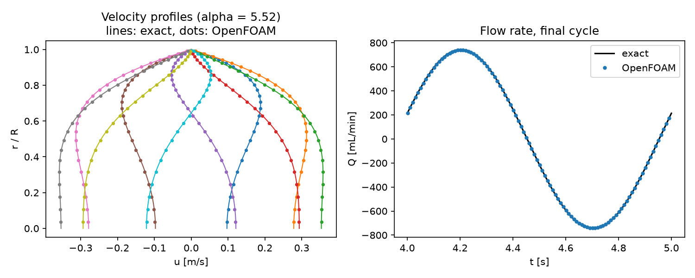

# Womersley pulsatile pipe flow

A verification case for pulsatile blood flow: laminar flow in a straight rigid tube driven by a harmonically oscillating pressure gradient. The fully developed solution is known exactly (Womersley, 1955), so the case checks the time accuracy and near-wall resolution of the solver set-up used for pulsatile biofluid simulations.

## Requirements

- OpenFOAM.com v2412
- `blockMesh`, `checkMesh`, and `pimpleFoam`
- `python3` with `numpy` for `validate.py` (`matplotlib` is optional and used for the figure)

## Case layout

```text
0/          Initial velocity and oscillating inlet pressure
constant/   Fluid and laminar flow dictionaries
system/     Mesh, solver, and sampling dictionaries
            makeBlockMeshDict.py regenerates system/blockMeshDict
validate.py Comparison with the exact Womersley solution
Allrun      Mesh, run, and validate
Allclean    Removes regenerated output only
```

## Model

The tube has radius R = 4 mm and length 20 mm along the y-axis, meshed with a 5-block O-grid (3,600 hexahedral cells) refined towards the wall. The kinematic pressure is fixed to `0.04 cos(2πt)` m²/s² at `INLET` and 0 at `OUTLET`; velocity is zero-gradient at both ends and no-slip at `WALL`. This gives a uniform driving gradient

−∂p/∂y = G₀ cos(ωt),  G₀ = 2 m/s²,  f = 1 Hz.

With kinematic viscosity 3.3 × 10⁻⁶ m²/s, the Womersley number is α = R√(ω/ν) = 5.52, typical of a medium-sized artery. `pimpleFoam` runs from rest for five cycles with Δt = 1 ms and second-order `backward` time stepping; start-up transients decay to below 0.3 % before the last cycle.

Exact solution (with Λ = i^{3/2} α):

u(r, t) = Re{ G₀/(iω) [1 − J₀(Λr/R)/J₀(Λ)] e^{iωt} }

## Run

```bash
./Allrun
```

The run takes about 2–3 minutes on one core. `Allrun` exits with a non-zero status if `validate.py` reports a failure. `./Allclean` removes generated results only.

## Validation

`validate.py` compares 20 radial velocity profiles (every 0.05 s) and the flow rate (every time step) over the final cycle with the exact solution. Both must agree to within 2 % of their peak values.

Result with OpenFOAM.com v2412:

| Quantity | Error (% of peak) |
| --- | ---: |
| Velocity profiles (max over 20 phases) | 0.42 |
| Flow rate (max over the cycle) | 0.52 |



The profiles show the characteristic near-wall velocity overshoot and the phase lag between the core and the Stokes layer.

## Limitations

The tube wall is rigid and the fluid Newtonian. A single harmonic is used; physiological waveforms are sums of harmonics, and the same set-up applies to each.

## Author, citation, and licence

Author: Chanikya Valeti.

Reference: J. R. Womersley, "Method for the calculation of velocity, rate of flow and viscous drag in arteries when the pressure gradient is known", *J. Physiol.* 127 (1955) 553–563.

If you use this testcase, please cite this repository and the OpenFOAM version used. No DOI is currently assigned.

No reuse licence is currently granted. Copyright © Chanikya Valeti; all rights reserved.
